

  

<h1 align="center">CORV GCS</h1>

  <b>A 3D ground control station for ArduPilot, INAV and Betaflight</b> 
  Windows, Linux and macOS · native C++ and Qt 6

  
  
  
  
  
  

  <a href="https://github.com/Xarin94/Corv-GCS/releases/latest"><b>Download</b></a> ·
  <a href="https://xarin94.github.io/Corv-GCS/">User guide</a> ·
  <a href="https://xarin94.github.io/Corv-GCS/getting-started.html">Getting started</a> ·
  <a href="https://xarin94.github.io/Corv-GCS/simulator.html">Try it without a vehicle</a> ·
  <a href="BUILDING.md">Build from source</a>

A ground control station is the software on the laptop that talks to the drone: it shows what the
vehicle is doing, lets you plan a flight and sends it to the autopilot. CORV GCS does that for
ArduPilot (Plane, Copter, Rover, Sub, Heli, VTOL) on a **real 3D model of the terrain**, and reads
INAV and Betaflight boards over MSP.

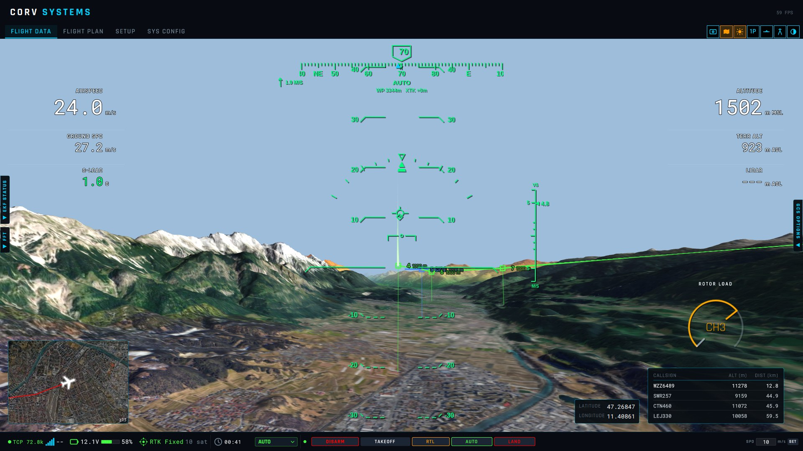

*Every picture on this page is the program itself, flying ArduPilot in simulation: a jet at
1470 m over Innsbruck, a copter surveying a slope above Lake Garda.*

## First person, over real terrain

The view from the aircraft, with the satellite imagery laid on the elevation model and an
aviation-style head-up display over it: pitch ladder, bank arc, flight-path marker, heading tape
and vertical speed, drawn with the conventions of airliner and Garmin displays. The imagery near
the vehicle is as sharp as on the 2D map, down to 10 cm per pixel.

Between two telemetry samples the view moves on the vehicle's own speed, acceleration and rotation
rates, so it stays smooth on a slow or bursty link.

## Synthetic vision

One key (**M**) trades the photographs for a drawn chart: contour lines every 10 m, brighter every
50 m, amber every 250 m, and a white line along the ridges and the horizon. It needs no imagery, and
the route and the predicted path stay readable at any distance.

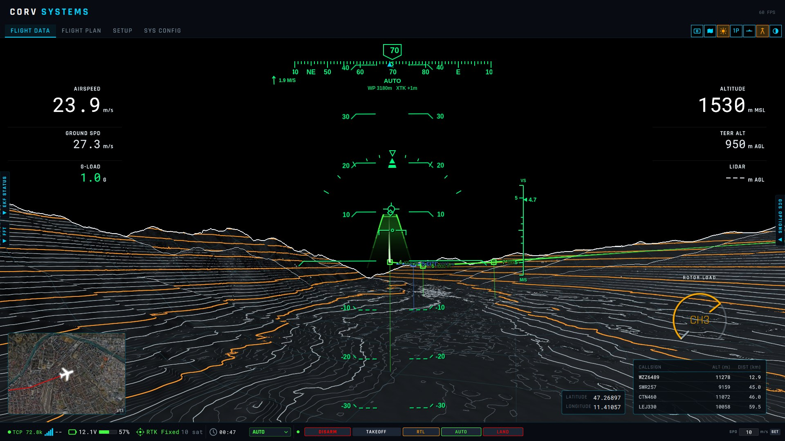

The light theme draws the same chart as green relief under a pale sky, for a screen in the sun.

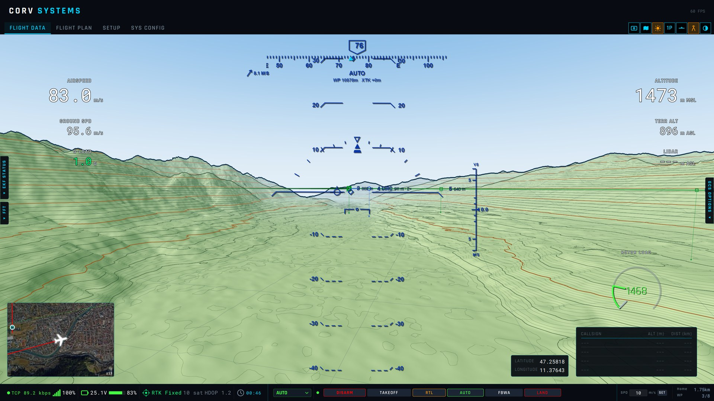

## The flight in 3D

Third person orbits the vehicle: the route with its waypoints and their heights above ground, the
trail flown, home, the predicted path and the air traffic around it.

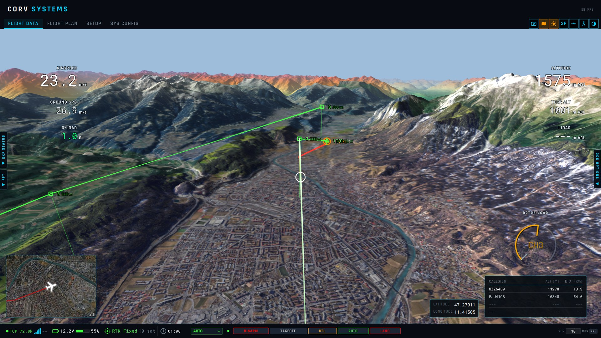

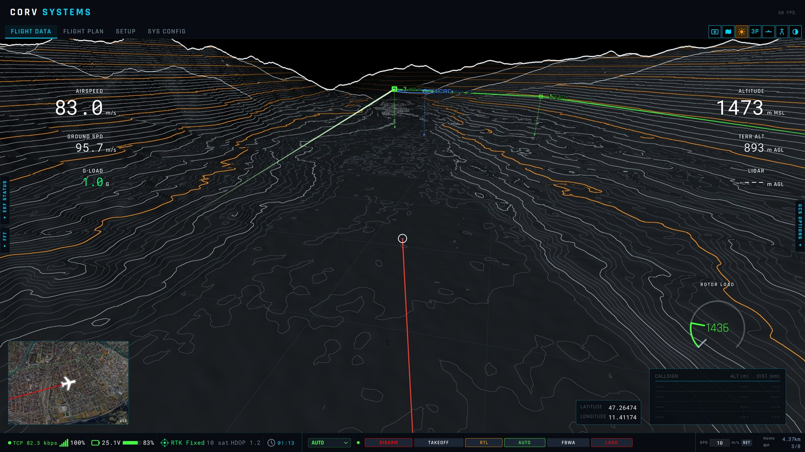

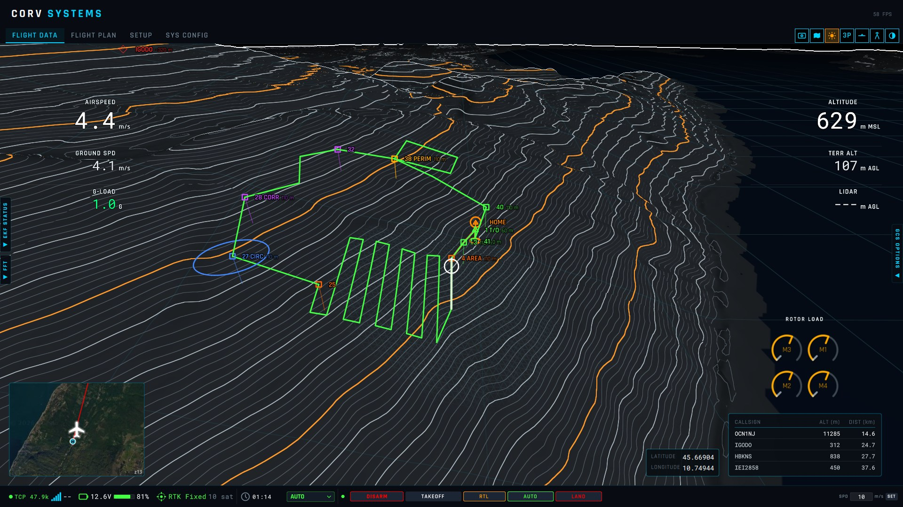

## Mission planning

You draw shapes (a waypoint, a circle, a perimeter, an area to photograph, a corridor, a point of
interest, a landing) and the route between them is calculated after every edit. For an area scan
the lanes and the photo spacing come from the camera. The elevation profile shows the ground under
the whole route, adds the waypoints needed to follow it, and lists any leg that passes too low
before you upload.

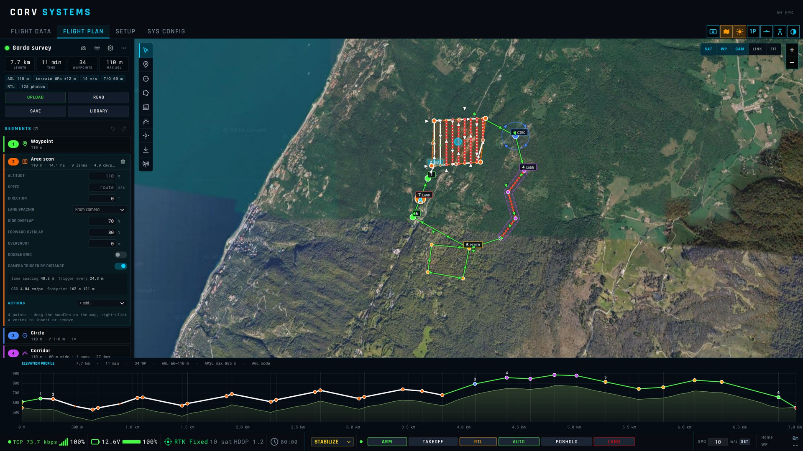

## Radio link coverage

Choose the radio, place the operator, and the map shows where the telemetry link will hold over the
real terrain: green where it is good, orange where hills degrade it, red where the margin is too
thin. It accounts for line of sight, the first Fresnel zone, diffraction over ridges and the
curvature of the Earth.

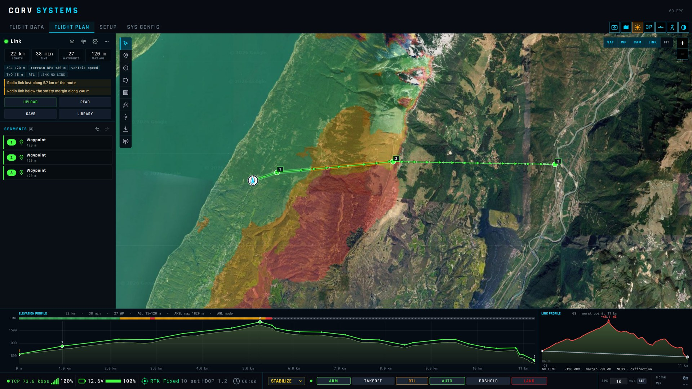

## Parameters, with their documentation

READ ALL takes a fraction of a second over MAVLink FTP on a fast link; on a slow radio you read
only the parameters you need. Every parameter comes with the ArduPilot documentation: description,
units, range, value lists, and bitmasks with every bit named.

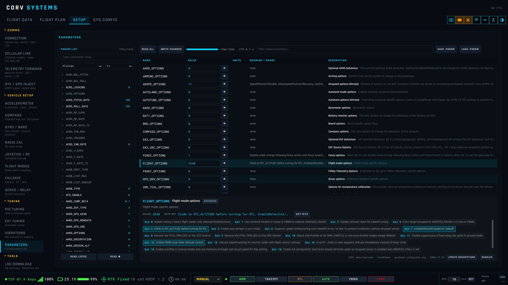

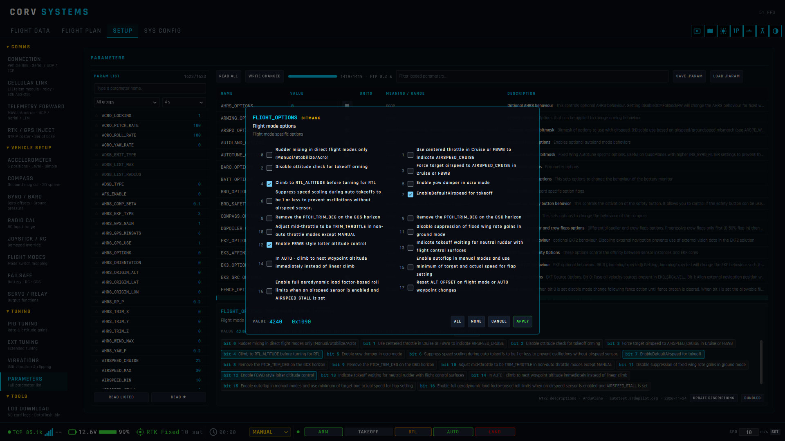

## Vibration analysis

The FFT bar shows the vibration spectrum, its strongest lines and a 60-second waterfall, computed
from the IMU samples of a `.bin` log while it replays.

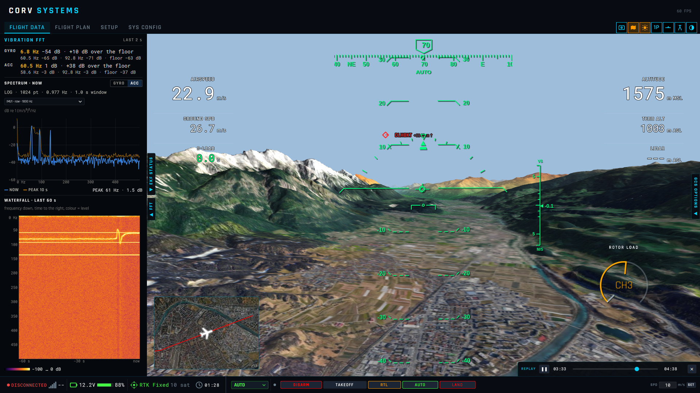

## Estimator health

The EKF STATUS bar charts the last 20 seconds of the estimator: innovation ratios, GPS accuracy and
EKF attitude against the backup DCM.

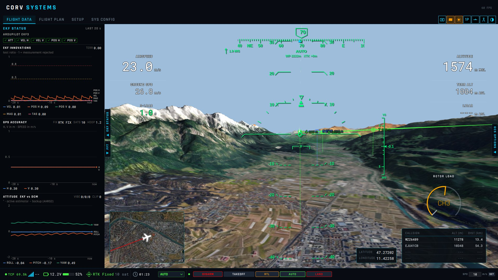

## Log replay

Every flight is recorded as a `.tlog` as soon as the link is up. `.tlog` and ArduPilot `.bin` logs
replay on the flight screen, with a timeline to scrub through.

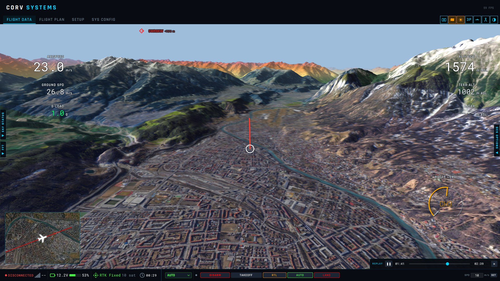

## Also on board

- **Annunciators**: 47 warnings and cautions for GPS, compass, IMU, EKF, radio, battery and failsafes.
- **Rotor load**: each motor by its output, with the RPM of its ESC; for a helicopter the rotor's
  RPM, the collective and the tail rotor.
- **Restricted zones**: UAS geographical zones on the maps and the terrain, with height warnings.
- **ADS-B traffic**: nearby aircraft on the map, in a table and in 3D.
- **Calibration**: accelerometer, level, gyro, barometer, and onboard compass calibration on a 3D sphere.
- **RTK**: corrections from an NTRIP caster or a serial base, forwarded to the vehicle.
- **Cellular link**: an LTEtelem module through an end-to-end encrypted relay, with the LTE cells on the map.
- **FPV video**: an RTSP camera (SIYI and similar) full screen, or with the synthetic view drawn over it.
- **LiDAR and ROS**: a Livox Mid-360 point cloud, or surfaces from LiDAR, echo sounder and sonar over rosbridge.
- **Water, ROVs and no GPS**: lakes and seas, depth under the surface, and a relative frame without GPS.
- **Joystick**: RC override from a gamepad, with servo and camera buttons.
- **Telemetry forwarding**: MAVLink over UDP or serial, or LTM to an antenna tracker.
- **Simulator**: ArduPilot SITL with one click.
- **English and Simplified Chinese**, switched while running.
- **Offline**: imagery and elevation downloaded for an area, for a flight with no network.

## Install

Packages are on the [Releases](https://github.com/Xarin94/Corv-GCS/releases) page. Windows has an
installer (`CORV-GCS-<version>-setup-x64.exe`) and a portable zip. Where a release carries no Linux
AppImage or macOS DMG, [build from source](BUILDING.md).

The program starts on a demo flight, so there is something to see before any vehicle is connected.
[Getting started](https://xarin94.github.io/Corv-GCS/getting-started.html) covers the first
connection.

| Method | Protocol | Typical use | Default |
|--------|----------|-------------|---------|
| Serial | MAVLink 2 | USB telemetry radio (SiK, RFD900…) | 57600 baud |
| UDP | MAVLink 2 | MAVProxy, MAVLink router | port 14550 |
| TCP | MAVLink 2 | SITL | `127.0.0.1:5760` |
| Serial / TCP | MSP v1 / v2 | INAV or Betaflight; missions on INAV | 115200 baud |

### Coming from 1.x

2.x is a rewrite, not an update of the Electron version. On Windows it installs next to 1.x, in its
own folder. Missions, logs, terrain and LTE cells keep the 1.x formats; the settings start again
and the map tiles are downloaded again. From 2.0.1 on, the program checks these releases at start
and installs a newer version in one click (SYS CONFIG → UPDATES). The 1.x sources stay at tag
`v1.8.8`.

## Documentation

The [wiki](https://xarin94.github.io/Corv-GCS/) explains every screen, button and setting, with the
ArduPilot page for each flight mode, mission command, failsafe and calibration. Its source is
[docs/](docs/). [BUILDING.md](BUILDING.md) has the build, the layout of the sources, the test hooks
and the state of each part.

Questions and bug reports: [issues](https://github.com/Xarin94/Corv-GCS/issues), or the
[thread on the ArduPilot forum](https://discuss.ardupilot.org/t/corv-gcs-open-source-3d-ground-control-station-for-ardupilot/142922).

## License

[Apache License 2.0](LICENSE)
