# CORV GCS wiki

CORV GCS is a ground control station: the software on the laptop that talks to the drone, shows what
it is doing, plans its missions and sends them to the autopilot. It works with ArduPilot vehicles
(Plane, Copter, Rover, Sub, Heli, VTOL), with INAV and Betaflight controllers over MSP, and draws
everything on a **real 3D model of the terrain**. It runs on Windows, Linux and macOS.

From version 2.0.1 on, CORV GCS is a native rewrite of the 1.x application with the same screens
and functions; it [updates itself](getting-started.md#updates) from the releases of this
repository. This guide was written for 1.x and is being brought up to date: where 2.0 differs it
says so.

This wiki explains every screen, page by page, down to the single switches: what each button does,
what each setting means and its default, and where the ArduPilot documentation describes what the
vehicle does with it.

[Download the latest release](https://github.com/Xarin94/Corv-GCS/releases/latest){: .btn .btn-primary .mr-2 }
[Source on GitHub](https://github.com/Xarin94/Corv-GCS){: .btn }

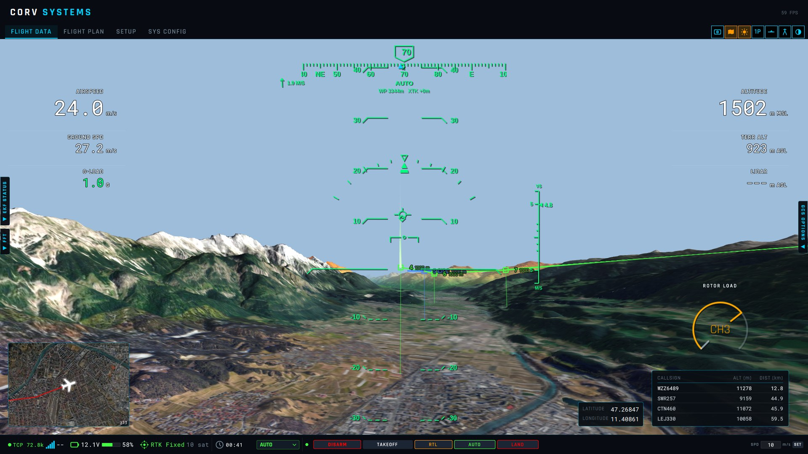

## What it looks like

The pictures are the program itself, flying ArduPilot in simulation: a plane at 1500 m over
Innsbruck, a copter surveying a slope above Lake Garda. Each links to the chapter that explains it.

### First person with synthetic vision

Contour lines, ridges and the horizon drawn from the elevation model, in the dark and in the light
theme: [Flight screen](flight-screen.md), [3D view](3D-NAVIGATION.md).

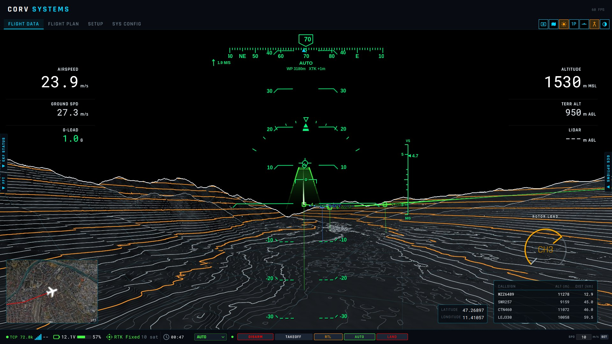

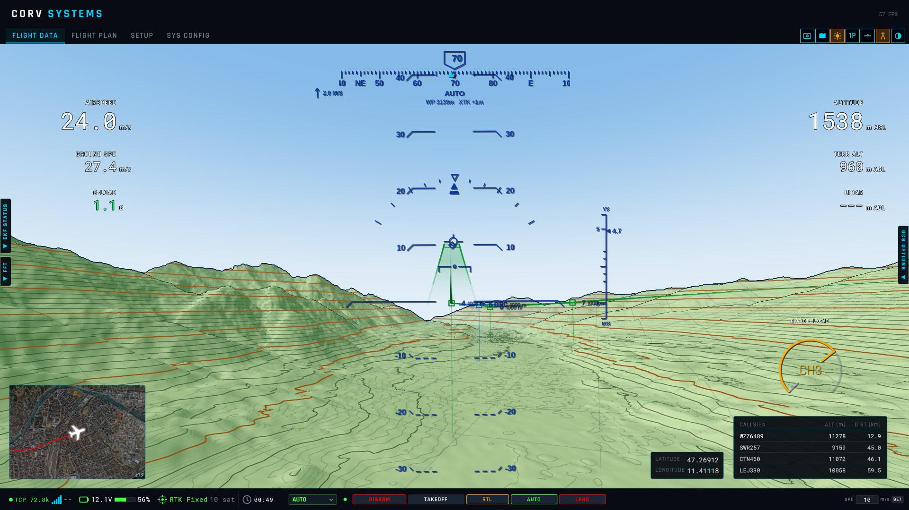

### 3D view

Third person around the vehicle, with the route, the heights above ground and the trail flown:
[3D view, water and ROVs](3D-NAVIGATION.md).

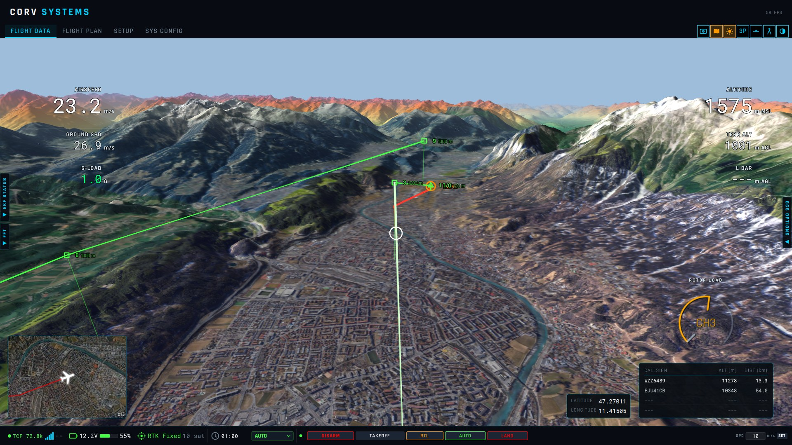

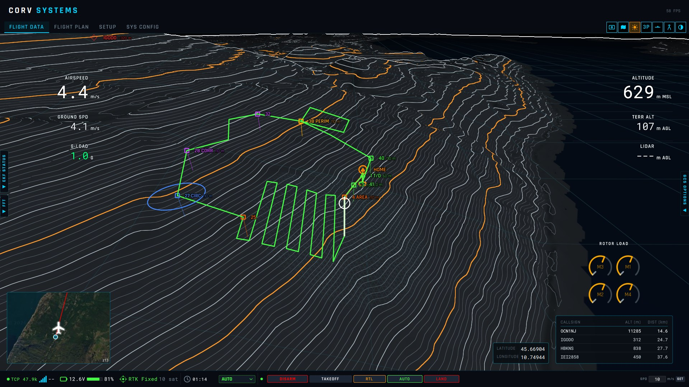

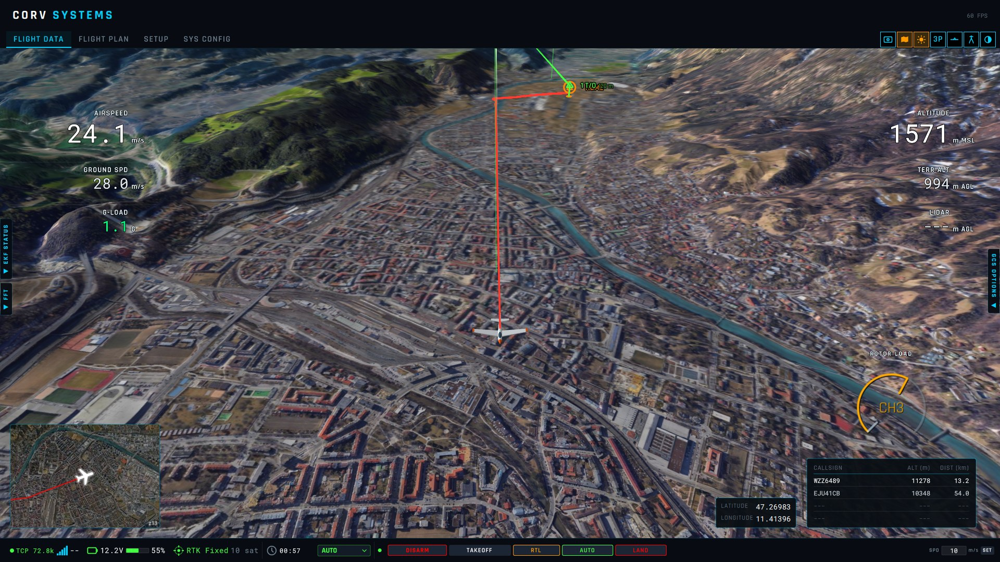

### Map and flight data

The mini-map swaps with the 3D view, and the EKF STATUS bar opens beside it:
[Mini-map](flight-screen.md#mini-map), [EKF status](flight-screen.md#ekf-status).

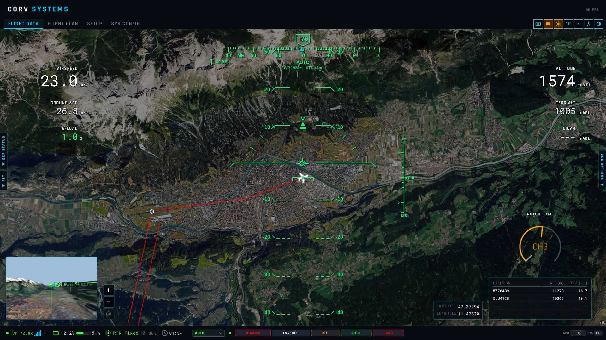

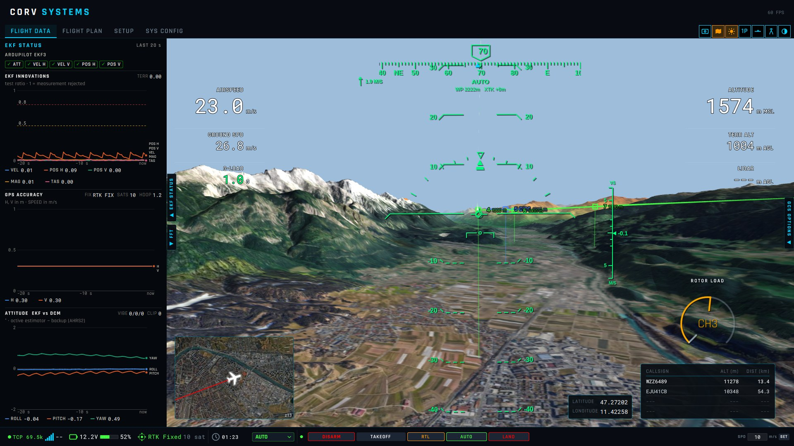

### Mission plan and radio link

[Mission planning](mission-planning.md), [Radio link planning](radio-link.md).

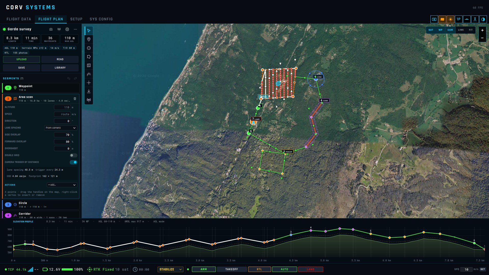

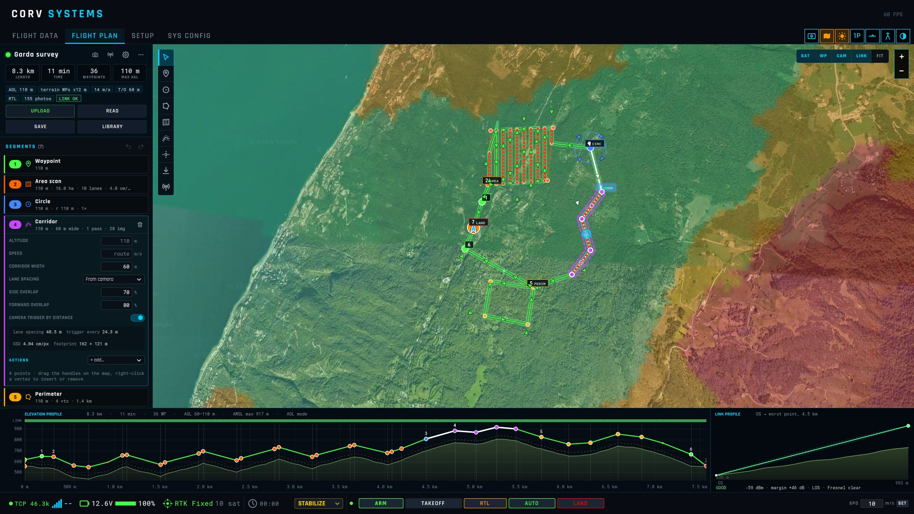

### Parameters and bitmasks

[Vehicle setup → Parameters](setup.md#parameters).

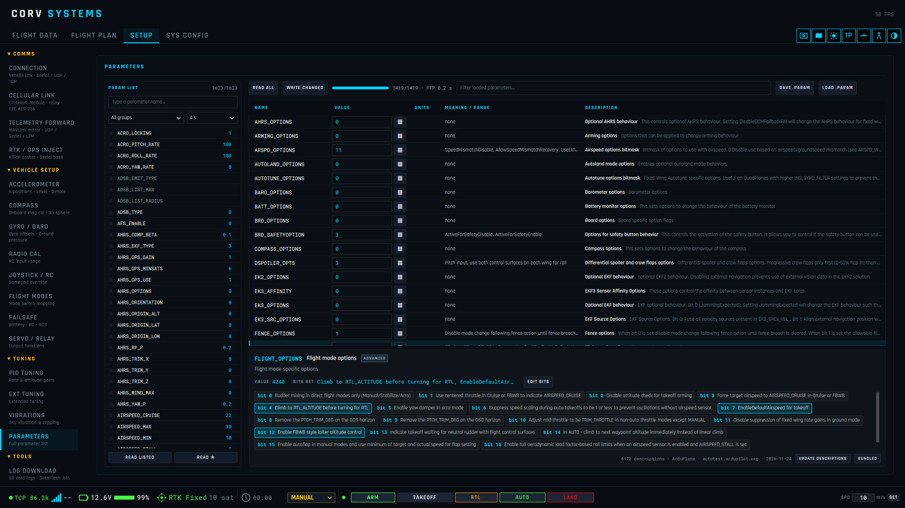

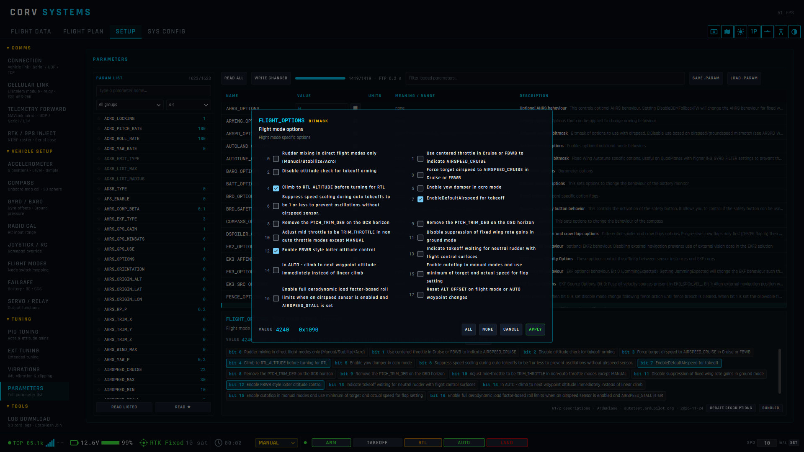

### Vibration FFT and log replay

[Vibration FFT](flight-screen.md#vibration-fft), [log replay](side-panel.md#log-replay).

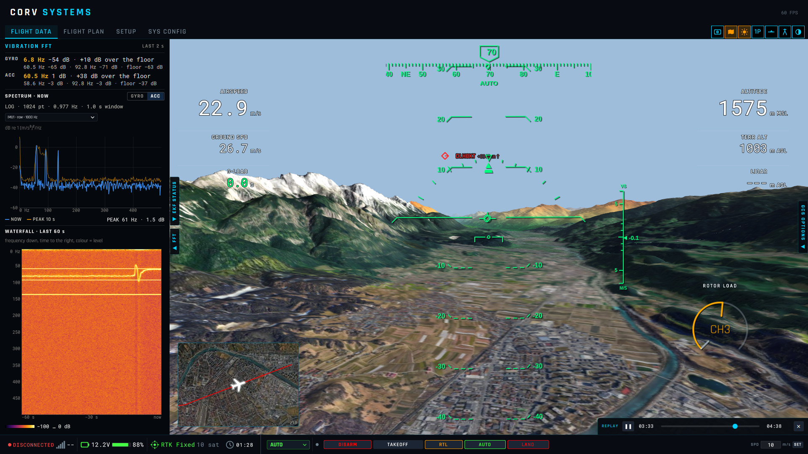

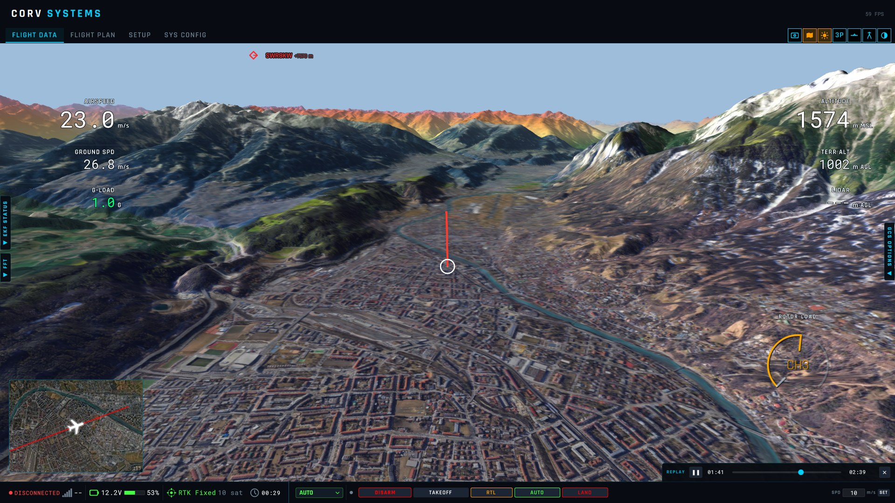

### Settings

[GCS settings](sys-config.md).

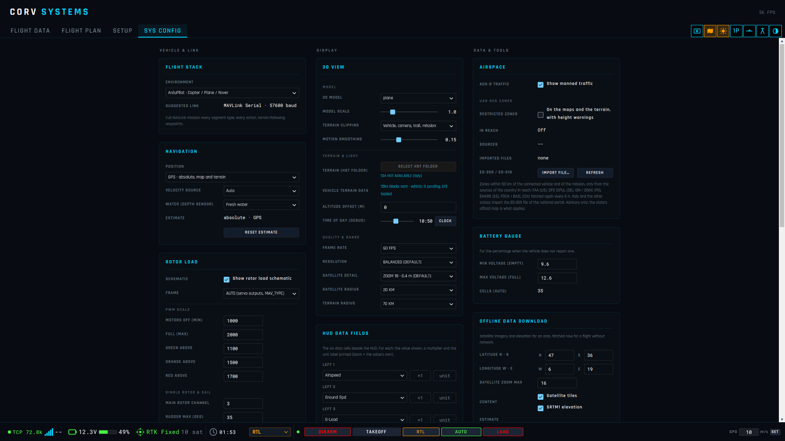

## Chapters

| Chapter | What it covers |
|---------|----------------|
| [Getting started](getting-started.md) | Installing, the first launch, terrain data, connecting a vehicle, choosing the flight stack |
| [Flight screen](flight-screen.md) | The FLIGHT DATA tab element by element: view buttons (FPV, satellite, sunlight, 1P/3P, horizon lock, trajectory, theme), HUD, data cells, every annunciator, ADS-B traffic, command bar, mini-map, rotor load, strips, FPV, logs and replay |
| [Side panel](side-panel.md) | The GCS controls on the right edge: set home, reboot, read mission, mute GCS output, ADS-B and rotor load switches, clear trail, RTL options, target, message log, log replay |
| [Flight modes](flight-modes.md) | Every mode the GCS offers for Copter, Plane, Rover, Sub and INAV, which ones need a position, and the ArduPilot page for each |
| [Mission planning](mission-planning.md) | Drawing a route as segments, every segment and route setting, the context menu, what each becomes on the autopilot, altitudes and terrain, camera and sonar surveys, upload, read-back, the mission library |
| [Radio link planning](radio-link.md) | Coverage over the terrain, Fresnel zone, the link profile along the route |
| [3D view, water and ROVs](3D-NAVIGATION.md) | The mission in 3D, the low-altitude grid, lakes and seas, ROVs, navigation without GPS |
| [Vehicle setup (SETUP)](setup.md) | Every SETUP page field by field: connection, cellular link, telemetry forwarding, RTK, calibrations, joystick, flight modes, failsafes, servos and relays, tuning, parameters |
| [GCS settings (SYS CONFIG)](sys-config.md) | Every SYS CONFIG panel: flight stack, navigation, rotor load, stream rates, 3D view (model, terrain, frame rate, satellite detail), HUD fields, camera stream, airspace (ADS-B, geo zones), battery gauge, offline download, FFT from logs, language and debug log |
| [Simulator](simulator.md) | ArduPilot SITL with one click, the survey boat and the ROV on Lake Garda, connecting to your own simulator |
| [LiDAR point cloud](LIDAR.md) | Livox Mid-360 mapping: network, mounting, telemetry lag, saving `.ply` |
| [ROS surface](ROS.md) | LiDAR, echo sounder and sonar from ROS (rosbridge): how to set it up step by step, every setting, the strip, troubleshooting, worked examples (aerial LiDAR, SLAM map, echo sounder, survey sonar, ROV in a cave) |
| [Keyboard shortcuts](shortcuts.md) | All keys and mouse actions, on the flight screen and in the planner |

## Where to start

| I want to… | Read |
|------------|------|
| connect a drone for the first time | [Getting started → connect a vehicle](getting-started.md#connect-a-vehicle), then [Flight screen → command bar](flight-screen.md#command-bar) |
| try the GCS without a vehicle | [Simulator](simulator.md) |
| plan and fly a survey | [Mission planning](mission-planning.md), [camera surveys](mission-planning.md#camera-surveys) |
| map the sea bed or terrain from a ROS sensor | [ROS surface → quick start](ROS.md#quick-start) |
| know what a red or amber flag means | [Annunciators](flight-screen.md#annunciators) |
| fly with no internet | [Offline data download](sys-config.md#offline-data-download) |
| understand why a button does nothing | [MUTE GCS OUTPUT](side-panel.md#gcs-options) may be on; the flight buttons need a vehicle connected |
| report a problem | [Debug log → SAVE COPY…](sys-config.md#application), and the issues page below |

## Where the ArduPilot documentation fits

CORV GCS shows, commands and plans; the vehicle's behaviour is ArduPilot's. Each chapter links the
[ArduPilot documentation](https://ardupilot.org/ardupilot/) page for what the GCS is driving — the
flight mode, the mission command, the failsafe, the calibration — so you can check what the
autopilot will actually do. When the two disagree, the autopilot documentation for your firmware
version wins.

## Community

Questions, bug reports and feature requests: the
[issues](https://github.com/Xarin94/Corv-GCS/issues) on GitHub, or the
[CORV GCS thread](https://discuss.ardupilot.org/t/corv-gcs-open-source-3d-ground-control-station-for-ardupilot/142922)
on the ArduPilot forum. Developers: [BUILDING.md](https://github.com/Xarin94/Corv-GCS/blob/main/BUILDING.md)
has the build, the layout of the sources and the state of each part.
