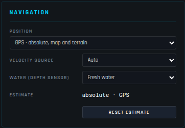

# GCS settings (SYS CONFIG)

The **SYS CONFIG** tab holds the settings of the ground station itself — what it shows and how — as
opposed to [SETUP](setup.md), which configures the vehicle. Everything here is remembered between
sessions on this computer, except where noted. One panel writes to the vehicle: **MAVLINK STREAM
RATES**.

The page is three columns, one theme each, read top to bottom:

| VEHICLE & LINK | DISPLAY | DATA & TOOLS |
|----------------|---------|--------------|
| [FLIGHT STACK](#flight-stack) — ArduPilot, INAV or Betaflight | [3D VIEW](#3d-view) — model, terrain, light, quality and range | [AIRSPACE](#airspace) — ADS-B traffic, UAS geo zones |
| [NAVIGATION](#navigation) — absolute (GPS) or relative position | [HUD DATA FIELDS](#hud-data-fields) — the six data cells beside the HUD | [BATTERY GAUGE](#battery-gauge) — voltage range for the percentage |
| [ROTOR LOAD](#rotor-load) — the motor output schematic | [SIYI CAMERA STREAM](#siyi-camera-stream) — the FPV video address | [OFFLINE DATA DOWNLOAD](#offline-data-download) — imagery and elevation ahead of time |
| [MAVLINK STREAM RATES](#mavlink-stream-rates) — how often the vehicle sends each group | | [FFT FROM LOGS](#fft-from-logs) — resolution of the spectra computed from a `.bin` |
| | | [APPLICATION](#application) — language, DevTools, debug log |

Every row is a label on the left and its control on the right; a note under the rows says what is
not obvious from the name.

---

## FLIGHT STACK

| Field | |
|-------|---|
| **ENVIRONMENT** | *ArduPilot · Copter / Plane / Rover*, *INAV · waypoint missions over MSP*, *Betaflight · acro, no navigation*. Decides the link protocol suggested, which SETUP pages are available and which mission features can be planned. |
| **SUGGESTED LINK** | The connection type and baud rate that go with it (MAVLink serial 57 600, MSP serial 115 200). |

The note underneath says what changes. Details in
[Getting started → choose the flight stack](getting-started.md#choose-the-flight-stack).

## NAVIGATION

| Field | |
|-------|---|
| **POSITION** | *GPS · absolute, map and terrain* (default) or *Relative · no GPS, plane at zero* — for a vehicle that has never had a GPS: a ROV, a flight with no GNSS. |
| **VELOCITY SOURCE** | What the GCS dead-reckons on when the vehicle sends no local position of its own: *Auto*, *Airspeed + heading*, *Ground speed + heading*, *EKF velocity*. |
| **WATER (DEPTH SENSOR)** | *Fresh* (997 kg/m³) or *Sea* (1 025 kg/m³) water, to turn a sub's pressure into depth. |
| **ESTIMATE** + **RESET ESTIMATE** | Where the position comes from right now; RESET ESTIMATE starts the relative position and its track again from zero. |

Everything about the relative mode — what it draws, the dead reckoning, what ArduPilot sends without
GPS — is in [navigation without GPS](3D-NAVIGATION.md#5-navigation-without-gps).

## ROTOR LOAD

The schematic at the bottom right of the flight screen, each motor coloured by its output. On a
sailboat, the wing and rudder dials (see [flight screen](flight-screen.md#bottom-right-rotor-load-position-traffic)).

| Field | Default | |
|-------|---------|---|
| **SCHEMATIC** — *Show rotor load schematic* | on | The same switch as **SHOW ROTOR LOAD** in the side panel. |
| **FRAME** | AUTO (from MAV_TYPE) | Or force: sailboat (wing + rudder), single rotor (plane / heli), tricopter, quad, hexa, octo, deca, dodeca. AUTO picks the sailboat dials for a Rover with `SAIL_ENABLE` or a MastRotation output. |
| PWM SCALE · **MOTORS OFF (MIN)** | 1000 | The PWM at which the gauges read empty. |
| **FULL (MAX)** | 2000 | The PWM at which they read full. |
| **GREEN ABOVE** | 1100 | Below it a motor reads **blue** (stopped). |
| **ORANGE ABOVE** | 1500 | |
| **RED ABOVE** | 1700 | A motor in the red for long is near its limit: no control margin left on that arm. |
| SINGLE ROTOR & SAIL · **MAIN ROTOR CHANNEL** | 3 | For a plane or helicopter, the output shown as the main rotor: ArduPlane throttle = 3, heli RSC = 8. |
| **RUDDER MAX (DEG)** | 35 | Sailboat: the rudder angle at full steering (`SERVOn_MIN` / `_MAX` of the rudder output). A property of the boat, not an ArduPilot parameter (AutoSail: 35). |

On a healthy multirotor in a hover all motors sit in the same colour; one constantly higher shows a
centre of gravity off to that side, a weak motor or a twisted arm.

## MAVLINK STREAM RATES

How many times a second the vehicle sends each group of messages (`SR0_*`, the rates of the
autopilot's SERIAL0 port, normally its USB):

| Field | Parameter | Default | Carries |
|-------|-----------|---------|---------|
| **RAW SENSORS** | `SR0_RAW_SENS` | 2 | IMU, pressure, raw GPS |
| **EXT STATUS** | `SR0_EXT_STAT` | 2 | system status, battery, GPS status, mission current |
| **RC CHANNELS** | `SR0_RC_CHAN` | 5 | RC inputs, servo outputs (radio calibration, rotor load) |
| **RAW CTRL** | `SR0_RAW_CTRL` | 1 | |
| **POSITION** | `SR0_POSITION` | 3 | GLOBAL_POSITION_INT, LOCAL_POSITION_NED |
| **EXTRA1 (ATTITUDE)** | `SR0_EXTRA1` | 10 | ATTITUDE |
| **EXTRA2 (VFR HUD)** | `SR0_EXTRA2` | 10 | VFR_HUD (speeds, altitude, climb) |
| **EXTRA3** | `SR0_EXTRA3` | 1 | vibration, EKF status, terrain, battery details |
| **PARAMS** | `SR0_PARAMS` | 10 | parameter download rate (the one-by-one fallback; the FTP download does not depend on it) |

**READ** loads the vehicle's values; **WRITE** sends all nine (each field flashes green when
written, red on failure). Lower them on a slow radio (a 19 200-baud link cannot carry everything at
10 Hz); raise POSITION and EXTRA1 to 10 Hz or more for the [LiDAR](LIDAR.md) and [ROS](ROS.md)
surfaces, which place every point with the telemetry pose.

WRITE also applies the rates to the link in use, whatever port of the autopilot it arrives on (a
radio or the cellular module on TELEM1 or TELEM2): it requests each group at the new rate and pins
ATTITUDE, ATTITUDE_QUATERNION, VFR_HUD, RAW_IMU and VIBRATION to it. These link rates last until the
autopilot restarts; to keep them, set that port's `SR1_*` or `SR2_*` in
[PARAMETERS](setup.md#parameters) as well. The autopilot refuses a rate above what its main loop
allows (STATUSTEXT *Requested rate … too fast. Increase SCHED_LOOP_RATE*). On the
[cellular link](setup.md#cellular-link) the GCS asks for the rates again whenever the module
restarts, for example when the drone is powered up.

---

## 3D VIEW

Three groups: the model, the terrain and its light, the rendering quality and range.

| Field | Default | |
|-------|---------|---|
| MODEL · **3D MODEL** | follows the vehicle | The aircraft model drawn in 3D: the `.glb` / `.gltf` files in the `models/` folder (quadcopter, hexa, octo, tricopter, plane, flying wing, quadplane VTOL, helicopter, rover, boat, ROV, submarine, airship, antenna tracker), plus your own. When a vehicle connects, the model switches to its type; choose another here to override. |
| **MODEL SCALE** | 1.0 | 0.1 to 5×: makes the model larger to find it at a distance, or true to size. |
| **GROUND CLAMP** — *Keep the model on the terrain* | on | Never draws the vehicle under the terrain model: where its altitude is below the ground (SRTM is ±5 m, barometers drift) it is lifted onto the surface, so a landed vehicle sits on the ground. Over water it does not apply (a ROV dives). Untick to see the raw altitude. |
| **MOTION SMOOTHING** | 0.15 | 0 to 0.5. Telemetry arrives at 25 Hz or less while the 3D view draws 60 frames a second. Above 0, the 3D view and the HUD carry the aircraft forward between samples (for at most 0.5 s after the last one, then it holds) on its reported velocity, acceleration and rotation rates, and blend each new sample in over the slider value × 0.5 s (75 ms at the default) instead of jumping to it. 0 = drawn exactly as received (moves in steps, most visible low and fast). |
| TERRAIN & LIGHT · **TERRAIN (HGT FOLDER)** → **SELECT HGT FOLDER** | | Load SRTM `.hgt` elevation tiles from a folder of your own (offline, or a better DEM). The line under it shows what is loaded (`NO DATA` before any terrain). Tiles are otherwise downloaded automatically — see [terrain and imagery](getting-started.md#terrain-and-imagery). |
| **ALTITUDE OFFSET (M)** | 0 | Added to every vehicle altitude in the 3D view and the altitude cell, to line the reported altitude up with the terrain model when they disagree (a barometer drift, a different geoid). Not remembered: it is a correction for the flight at hand. |
| **TIME OF DAY (DEBUG)** | the clock | Moves the sun to any time (00:00–24:00) for the sunlight shading — to check a shadow or simply see better. |
| **MAP BRIGHTNESS** | 0.85 | 0.3 to 1.6. Shown only when the sunlight is off or the satellite imagery is off: the brightness of the flat-lit imagery, or of the whole schematic chart. |
| QUALITY & RANGE · **FRAME RATE** | 60 FPS | *60 FPS* or *30 FPS (ECO)*: 30 halves the rendering work — use it on battery or on a weak GPU. |
| **RESOLUTION** | BALANCED | *NATIVE*, *BALANCED* or *ECO*: the resolution the 3D scene is rendered at. HUD and text keep the display's resolution whatever is chosen. |
| **SATELLITE DETAIL** | zoom 18 · 0.4 m | The sharpest imagery drawn around the aircraft: zoom 16 (off) to 20 (0.1 m per pixel). Each step doubles the detail and the download — see [satellite detail](flight-screen.md#satellite-detail). |
| **SATELLITE RADIUS** | 10 km | How far around the aircraft the 3D terrain has satellite imagery: 5, 10, 15, 20 or 30 km. Beyond it the terrain is coloured by height. A wider radius downloads more tiles (for offline flights, make the [offline download](#offline-data-download) box cover it) and asks more of the computer: on a weak one stay at 10–15 km. See [terrain range and haze](flight-screen.md#terrain-range-and-haze). |
| **TERRAIN RADIUS** | 35 km | How far around the aircraft the 3D terrain is built: 35, 50 or 70 km. The haze follows it: a farther edge, thinner haze. 50 km builds about twice the terrain of 35 km and 70 km four times, with more elevation tiles in memory (25 MB each). |

## HUD DATA FIELDS

The six data cells beside the HUD: **LEFT 1–3** and **RIGHT 1–3**, top to bottom. Each row is the
field, the multiplier and the unit label:

| Control | |
|---------|---|
| Field | Airspeed, Ground Spd, Vert Speed, G-Load, Altitude (MSL), Terr Alt (AGL), LiDAR, Roll, Pitch, Heading, Battery V / A / %, GPS Sats, GPS HDOP, Link Qual, Vib X / Y / Z, AoA, SSA (sideslip), RTK Base (baseline, mm), RTK Acc (accuracy, mm) |
| Multiplier (×1) | The value is multiplied by it: ×3.6 shows m/s as km/h, ×1.944 as knots, ×3.281 metres as feet. |
| Unit | Your own unit label for the cell (`km/h`, `kt`, `ft`); empty = the field's own. |

**RESET DEFAULTS** goes back to Airspeed, Ground Spd, G-Load / Altitude, Terr Alt, LiDAR.

## SIYI CAMERA STREAM

The RTSP video for the [FPV button](flight-screen.md#fpv-video):

| Field | Default (SIYI) |
|-------|----------------|
| **IP ADDRESS** | 192.168.144.25 |
| **RTSP PORT** | 8554 |
| **STREAM PATH** | /main.264 |
| **TARGET FPS** | 30 (1–60) |

The PC's network adapter needs a static IP in the camera's subnet (for SIYI 192.168.144.x, e.g.
192.168.144.100), and `ffmpeg` must be installed and in the PATH. Any RTSP camera works with its
own address and path (`rtsp://IP:PORT/PATH`).

---

## AIRSPACE

What else is drawn in the air around the vehicle: manned traffic, and where drones may not fly.

| Field | Default | |
|-------|---------|---|
| **ADS-B TRAFFIC** — *Show manned traffic* | on | Manned aircraft from OpenSky and from an onboard receiver, in 3D, on the mini-map and in the traffic table. The same switch as **SHOW ADS-B TRAFFIC** in the side panel. See [ADS-B traffic](flight-screen.md#ads-b-traffic). |

### UAS GEO ZONES

Where drones may not fly, or only up to a height: see
[restricted zones](flight-screen.md#restricted-zones) for what is shown and the flags.

| Field | |
|-------|---|
| **RESTRICTED ZONES** | On / off, the same switch as in the side panel. Off by default. |
| **IN REACH** | How many zones are within 50 km of the vehicle and of the mission's points, and how many tiles are still being fetched. *No vehicle position and no mission* when there is nothing to look around. |
| **SOURCES** | The online sources asked for the places in reach, with tiles ready / needed and the last error if one failed: FAA (US), DFS DIPUL (DE), IGN / DGAC (FR), ENAIRE (ES), FOCA / BAZL (CH). *None in reach* elsewhere: import the state's file. |
| **IMPORTED FILES** | ED-269 / ED-318 files loaded, with their zone count; ✕ removes one. |
| **IMPORT FILE…** | Load a state's UAS geographical zones file (ED-269 or ED-318 JSON). Italy: [D-Flight](https://www.d-flight.it), profile page → **Download UAS Zone Geo** (unzip it first). Kept until removed; import a new copy when the state updates it. |
| **REFRESH** | Forget the downloaded zones and fetch them again now (they are fetched again by themselves every 6 hours). Imported files are kept. |

The downloads are kept under `data/geozones` and work offline once fetched.

## BATTERY GAUGE

The voltage range behind the battery percentage, used when the vehicle does not report one.

| Field | Default | |
|-------|---------|---|
| **MIN VOLTAGE (EMPTY)** | 9.6 V | The empty voltage. |
| **MAX VOLTAGE (FULL)** | 12.6 V | The full voltage. |
| **CELLS (AUTO)** | 3S | The cell count worked out from the maximum (4.2 V per cell): check it matches your pack. |

Example for a 6S Li-ion pack: min 18.0 V (3.0 V per cell), max 25.2 V.

## OFFLINE DATA DOWNLOAD

Downloads an area ahead of a flight without network.

| Field | |
|-------|---|
| **LATITUDE N · S** / **LONGITUDE W · E** | The box, in whole degrees: north and south edge, west and east edge. |
| **SATELLITE ZOOM MAX** | The sharpest imagery to keep, 1–19 (16 ≈ 2 m per pixel; every level up is four times the tiles). |
| **CONTENT** — *Satellite tiles* / *SRTM1 elevation* | What to download: imagery, 30 m elevation tiles, or both. |
| **ESTIMATE** | How many tiles and how much data the choice means — check it before starting; *AREA TOO LARGE* asks for a smaller box or zoom. |
| **DOWNLOAD** / **CANCEL** | Start / stop; a progress bar and a status line follow. |

Tiles go to the same cache the GCS fills while flying, so they are used automatically. For a
mission area, a box of 1° × 1° at zoom 16 is a good start; add zoom 18–19 only for the few square
kilometres you will fly low over.

## FFT FROM LOGS

How finely the GCS computes the vibration spectra of the [FFT bar](flight-screen.md#vibration-fft)
from the IMU samples of a DataFlash log (`.bin`) in
[LOG REPLAY](side-panel.md#log-replay). The spectrum a connected vehicle sends (`HPF_FFT_ENABLE` = 1)
is computed by the firmware and does not change: 256 points at 800 Hz, a bin every 3.125 Hz, four
times a second. A change here recomputes the loaded log at once.

| Field | Default | |
|-------|---------|---|
| **FFT SIZE** | 1024 points | 256 to 8192. The frequency step is the log's sample rate divided by this: a gyro logged at 2 kHz gives 1.95 Hz with 1024 points, 0.49 Hz with 4096. More points separate closer lines (two motors at nearly the same speed) but each spectrum covers more of the log (0.5 s and 2 s there), so a change of throttle smears. |
| **AVERAGING** | none | 2, 4 or 8 windows, each overlapping the next by half, their spectra averaged (Welch). The noise floor gets steadier and weak lines come out of it; the stretch of log behind each spectrum grows: 2.5× the FFT for 4 windows. |
| **TIME STEP** | 0.25 s | A new spectrum every step of log time: the columns of the waterfall. |
| **LOG IN REPLAY** | | For the `.bin` loaded: the stream behind the gyro and the accelerometer spectra, the frequency step and the stretch of log per spectrum they get. **Left out, in fragments**: IMU samples the logger kept only in bursts, with holes between them (typically an 8 kHz gyro logged in full), that no FFT window fits in. |

The log needs IMU samples (ArduPilot: [raw IMU logging](https://ardupilot.org/copter/docs/common-raw-imu-logging.html)
and [IMU batch sampling](https://ardupilot.org/copter/docs/common-imu-batchsampling.html)). The GCS
uses, best first:

- **GYR / ACC**, every sample at the sensor rate (`LOG_BITMASK` bit IMU_RAW, or `INS_RAW_LOG_OPT` for
  the gyros). With `INS_RAW_LOG_OPT` "pre and post filter" each gyro is there twice, the second copy
  after the low-pass and notch filters: **IMUn · filtered**.
- **Batch sampler** (`INS_LOG_BAT_MASK`): `INS_LOG_BAT_CNT` samples in a row (1024 by default), the
  sensors in turn, so one spectrum every few seconds per sensor. An FFT never spans more than one
  batch: with more points or averaging than fit, the GCS uses the most that do and says so.
- **IMU** at the loop rate, filtered: the only choice on most logs, and enough for the slow end of
  the spectrum (half the loop rate: 200 Hz for a copter at 400 Hz, 25 Hz at 50 Hz). Records the
  logger dropped are filled in, as the firmware does for the live spectrum.

The levels are those of the live spectrum (dB of (rad/s)²/Hz for the gyro and (m/s²)²/Hz for the
accelerometer, three axes summed), so the same line reads the same live and from the log.

## APPLICATION

| Field | Default | |
|-------|---------|---|
| **LANGUAGE** | English | English or 中文 (Simplified Chinese), for the whole interface. |
| **DEVTOOLS** → **OPEN DEVTOOLS** | | Opens the Chromium developer tools (console, network) in a separate window — for troubleshooting with support. |
| **DEBUG LOG (LAST 5 MIN)** → **SAVE COPY…** | | Saves one file with the last 5 minutes of this session and of the previous one (connections, errors, autopilot messages, commands sent): **send it to support** when reporting a problem. The path saved to is shown underneath. |
| **SHOW FILE** | | Shows the live debug log file in the file manager (`data/debug/corv-gcs-debug.log`, rewritten every few seconds). |
